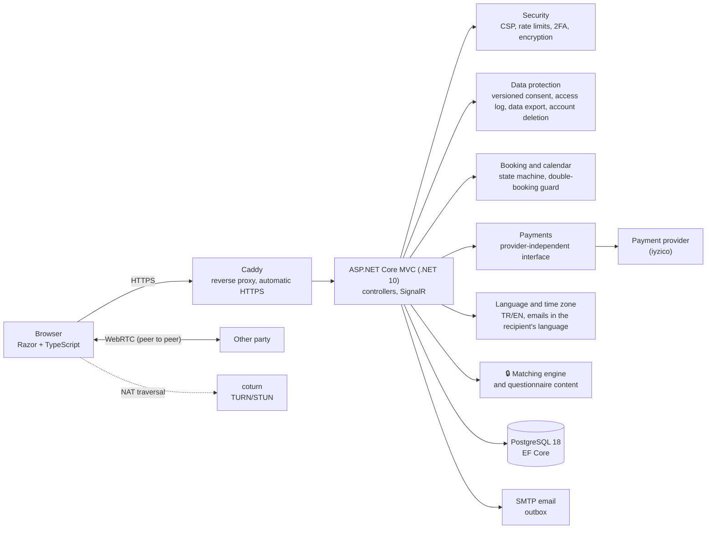

# Moodica — Online Therapy Platform (showcase)

[Türkçe](README.md) · **English**

Moodica matches a client, through a short needs assessment, with a suitable psychologist or psychiatrist who applies evidence-based methods, and brings booking, payment, video sessions and post-session follow-up into one place. **The system does not diagnose.**

> This repository is the **showcase** of a private main project: it is generated automatically from the main project and is never edited by hand. It contains selected files that show the architecture and engineering approach; the core of the product (matching engine and questionnaire content) is not here. The code is **readable but cannot be built or run on its own**. See [What is and is not in this repository](#what-is-and-is-not-in-this-repository).

## Problem

People looking for psychological support often do not know which professional to choose. Directories usually show only titles, prices and photos; nothing links the person's difficulty to the strength of evidence behind the method a professional uses. A poor match costs time and money and often leads people to drop out. Mental health data is also among the most sensitive kinds of personal data and must be protected carefully.

## Approach

1. **Needs assessment:** The client completes a questionnaire built from short, validated screening scales: PHQ-9 for depression [[1]](#k1), GAD-7 for anxiety [[2]](#k2), [[3]](#k3), PC-PTSD-5 for post-traumatic stress [[4]](#k4), SCOFF for eating problems [[5]](#k5), plus questions on panic, obsessive symptoms and sleep.
2. **Explainable matching:** A rule-based engine recommends professionals who apply evidence-based methods for the areas that stand out [[6]](#k6) and shows a "why recommended" reason for each. No diagnostic language is shown to the client.
3. **Safety first:** If a crisis item is marked, emergency helplines are shown immediately, the client's appointments become priority and the professional receives a notification without details.
4. **Booking and payment:** The client picks a free slot, the slot is held briefly, payment happens on the payment provider's page and the appointment is confirmed once the server verifies it.
5. **Video session:** In the browser, peer to peer (WebRTC); sessions are never recorded.
6. **After the session:** Feedback, a suggested next appointment, optional progress measures and self-help content.

The site is available in Turkish and English; times are shown in each person's time zone.

## Screens

| | |
| --- | --- |
|  |  |
| Expert directory and filters | Client dashboard |
|  |  |
| Expert dashboard | Phone view |

Screenshots were taken with demo data; all people are fictional.

## Architecture

The box marked 🔒 is not in this repository.

## Design decisions and rationale

| Decision | Why | Basis |
| --- | --- | --- |
| The system does not diagnose; the questionnaire is for screening and recommendation only | Diagnosis is the professional's job; diagnostic language can mislead clients | Ethical principles of mental health care |
| Matching is rule-based and explainable (no machine learning) | Every recommendation must answer "why" and be auditable by a clinician | Levels of evidence [[6]](#k6) |
| Only validated scales; their wording is never changed | Made-up questions do not give reliable results | [[1]](#k1)–[[5]](#k5) |
| Immediate referral and priority on a crisis item | The platform is not an emergency service; risk must be routed correctly at once | PHQ-9 item 9 [[1]](#k1) |
| Health data encrypted at field level; keys protected by a certificate | Even if the database leaks, content stays unreadable | Turkish data protection law (KVKK), special category data |
| No session recording; video is peer to peer | No unnecessary data is kept; data that is not stored cannot leak | Data minimisation |
| Every time a professional views health data it is logged, and people can see their own log | Access is transparent and auditable | KVKK art. 11 |
| Consent and privacy notices are versioned | When a text changes, everyone confirms again | KVKK |
| Payments behind a provider-independent interface | Development continues before the provider is final, and the provider can change later | — |
| Times stored in UTC, shown in each person's zone | Clients abroad and daylight saving time | — |
| Emails sent through an outbox and a background worker | No email is lost on an SMTP error; it is retried | Outbox pattern |
| No external CDN; all files served from our own server | Users' IP addresses are not sent to third parties; strict CSP | KVKK, cross-border transfer |
| Migrations run as a separate step, not on startup | New code never runs against an old schema; a backup comes first | Deployment safety |
| Integration tests against a real PostgreSQL | Authorization and data rules are verified on a real database | Testcontainers |
| This showcase is generated automatically from the main project | A manual copy drifts; an allowlist prevents secrets from leaking | [Synchronisation](#synchronisation-and-provenance) |

## Results

The figures below come from the main project's test and CI runs (29 October 2026):

| Measure | Result |
| --- | --- |
| Unit tests (.NET, xUnit v3) | 886 / 886 passed |
| Integration tests (real PostgreSQL, HTTP) | 211 / 211 passed |
| Front-end tests (TypeScript, Vitest) | 25 / 25 passed |
| Showcase export tests (pytest) | 48 / 48 passed |
| CI (build, all tests, Docker image) | On every push; `main` green |
| Interface languages | Turkish, English (1,298 strings) |

## Technology

.NET 10 · ASP.NET Core MVC · Entity Framework Core · PostgreSQL 18 · ASP.NET Core Identity (TOTP 2FA) · SignalR · WebRTC · coturn · TypeScript + Vite · MailKit · iyzico · Serilog · xUnit v3 · Testcontainers · Vitest · Docker · Caddy · GitHub Actions

## What is and is not in this repository

| Included | Not included |
| --- | --- |
| Security: CSP and security headers, rate limits, admin panel address restriction, reverse proxy settings, field-level encryption, two-factor authentication, authorization filters | 🔒 Matching engine, scoring and evidence tables |
| Data protection: versioned consent, health data access log, access report, account deletion | 🔒 Survey items, scale texts and survey screens |
| Booking: rules, free slot calculation, working hours, state machine | 🔒 Demo scenarios and expected results |
| Real time: video signalling hub, notification hub, TURN credential generation | Draft legal texts and clinical content |
| Payments: provider interface, iyzico adapter, exchange rates | Payment rules and commercial settings |
| Language: JSON-based translation, emails in the recipient's language, time zones | Configuration files, deployment settings, keys and passwords |
| Email: outbox and background worker | Internal documents, working notes, history |
| Selected unit and integration tests, `Dockerfile`, Caddy configuration, the main project's CI definition | The main project's history before this showcase (see below) |

## Synchronisation and PROVENANCE

The showcase is never updated by hand. Whenever a new commit reaches the main project's `main` branch, a workflow:

1. Reads only the files **listed one by one in the main project's allowlist**, from the **commit**, not from disk.
2. Runs every file through a deny list, a secret scan and a scan for terms belonging to the core; on a single violation nothing is written.
3. If anything changed, commits to this repository with the main project's commit subject and date.

[`PROVENANCE.md`](PROVENANCE.md) is rewritten on every sync: source commit, date, file count and the SHA-256 of every file, so each file here can be traced to the commit it came from.

## References

1. Kroenke K, Spitzer RL, Williams JBW. The PHQ-9: validity of a brief depression severity measure. *J Gen Intern Med.* 2001;16(9):606–613. — Depression screening and the crisis item.
2. Spitzer RL, Kroenke K, Williams JBW, Löwe B. A brief measure for assessing generalized anxiety disorder: the GAD-7. *Arch Intern Med.* 2006;166(10):1092–1097. — Anxiety screening.
3. Konkan R, Şenormancı Ö, Güçlü O, Aydın E, Sungur MZ. Validity and reliability study for the Turkish adaptation of the Generalized Anxiety Disorder-7 (GAD-7) scale. *Archives of Neuropsychiatry.* 2013;50:53–58. — Turkish validation of GAD-7.
4. Prins A, Bovin MJ, Smolenski DJ, et al. The Primary Care PTSD Screen for DSM-5 (PC-PTSD-5): development and evaluation within a veteran primary care sample. *J Gen Intern Med.* 2016;31(10):1206–1211. — Post-traumatic stress screening.
5. Morgan JF, Reid F, Lacey JH. The SCOFF questionnaire: assessment of a new screening tool for eating disorders. *BMJ.* 1999;319(7223):1467–1468. — Eating problems screening.
6. Australian Psychological Society. *Evidence-based psychological interventions in the treatment of mental disorders: A review of the literature.* 4th ed. Melbourne: APS; 2018. — Evidence-based methods and levels of evidence by area.

## License

Copyright © 2026 Halit Kılıç. **All rights reserved.** This repository is published for review only; see [LICENSE](LICENSE).
