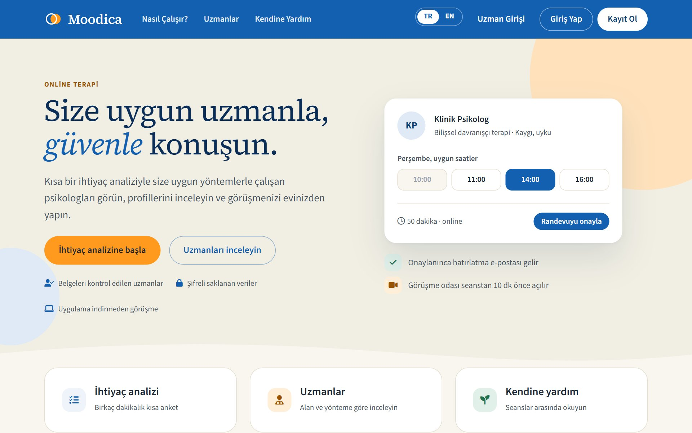
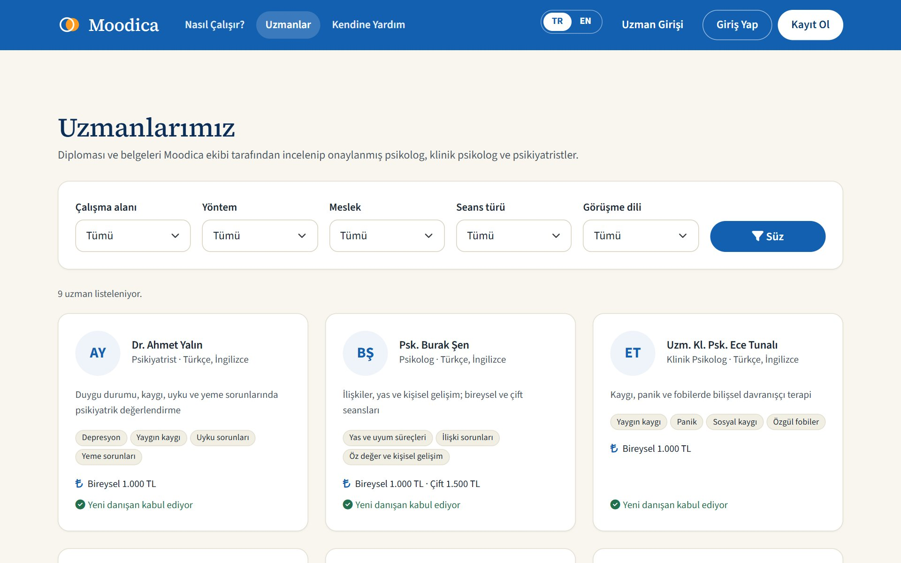
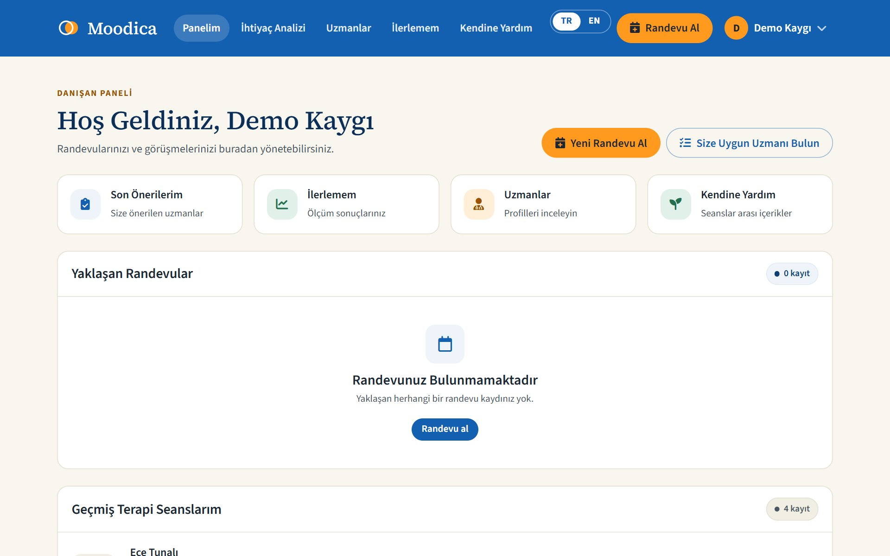
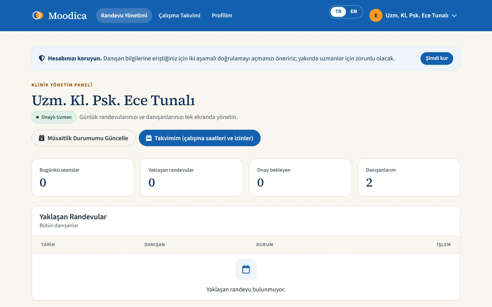
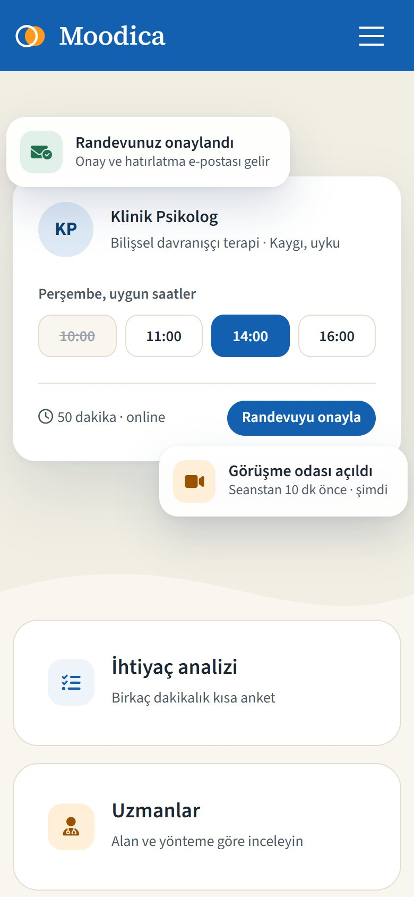
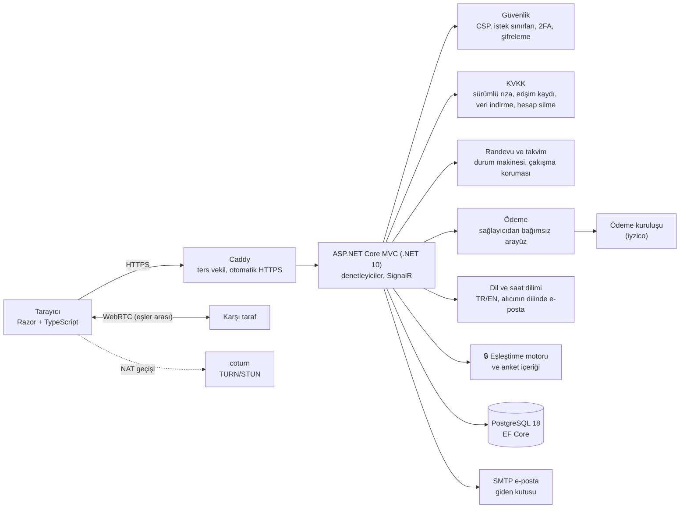

# Moodica — Online Terapi Platformu (vitrin)

**Türkçe** · [English](README.en.md)

Moodica, danışanı kısa bir ihtiyaç analiziyle kanıta dayalı yöntemler uygulayan uygun psikolog veya psikiyatristle eşleştiren; randevu, ödeme, görüntülü seans ve seans sonrası takibi tek yerde sunan bir online terapi platformudur. **Sistem teşhis koymaz.**

> Bu depo, private ana projenin **vitrinidir**: ana projeden otomatik üretilir, elle düzenlenmez. Mimariyi ve mühendislik yaklaşımını göstermek için seçilmiş dosyaları içerir; ürünün çekirdeği (eşleştirme motoru ve anket içeriği) burada yoktur. Kod **okunabilir ama tek başına derlenip çalıştırılamaz**. Ayrıntı: [Bu depoda ne var, ne yok](#bu-depoda-ne-var-ne-yok).

## Problem

Psikolojik destek arayan biri çoğu zaman hangi uzmana gitmesi gerektiğini bilmez. Uzman listeleri genellikle unvan, fiyat ve fotoğraftan ibarettir; kişinin yaşadığı sorunla uzmanın uyguladığı yöntemin kanıt düzeyi arasında bir bağ kurulmaz. Yanlış eşleşme zaman ve para kaybına, çoğu zaman da tedaviyi bırakmaya yol açar. Bunun yanında ruh sağlığı verisi en hassas kişisel veri türüdür ve özenli korunmalıdır.

## Yaklaşım

1. **İhtiyaç analizi:** Danışan, geçerliliği gösterilmiş kısa tarama ölçeklerinden oluşan bir anket doldurur: depresyon için PHQ-9 [[1]](#k1), kaygı için GAD-7 [[2]](#k2), [[3]](#k3), travma sonrası stres için PC-PTSD-5 [[4]](#k4), yeme sorunları için SCOFF [[5]](#k5), ayrıca panik, obsesif belirtiler ve uyku soruları.
2. **Açıklanabilir eşleştirme:** Kurala dayalı bir motor, öne çıkan alanlarda kanıta dayalı yöntem uygulayan uzmanları [[6]](#k6) önerir ve her öneri için "neden önerildi" gerekçesini gösterir. Danışana tanı dili gösterilmez.
3. **Güvenlik önce:** Kriz belirtisi işaretlenirse danışana hemen acil yardım hatları gösterilir, randevuları öncelikli olur ve uzmana ayrıntısız bildirim gider.
4. **Randevu ve ödeme:** Uzmanın boş saatlerinden seçim, saat kısa süre ayrılır, ödeme ödeme kuruluşunun sayfasında yapılır ve sunucuda doğrulanınca randevu onaylanır.
5. **Görüntülü seans:** Tarayıcıda, eşler arası (WebRTC); seanslar kaydedilmez.
6. **Seans sonrası:** Geri bildirim, ikinci randevu önerisi, isteğe bağlı ilerleme ölçümü ve kendine yardım içerikleri.

Site Türkçe ve İngilizcedir; saatler kişinin saat diliminde gösterilir.

## Ekranlar

| | |
| --- | --- |
|  |  |
| Uzman listesi ve süzgeçler | Danışan paneli |
|  |  |
| Uzman paneli | Telefon görünümü |

Ekran görüntüleri demo verisiyle alınmıştır; kişiler hayalidir.

## Mimari

🔒 işaretli kutu bu depoda yoktur.

## Tasarım kararları ve gerekçeleri

| Karar | Neden | Dayanak |
| --- | --- | --- |
| Sistem teşhis koymaz; anket yalnızca tarama ve öneri içindir | Tanı uzmanın işidir; tanı dili danışanı yanıltabilir | Ruh sağlığı alanının etik ilkeleri |
| Eşleştirme kurala dayalı ve açıklanabilir (makine öğrenmesi yok) | Her öneri "neden" sorusuna cevap verebilmeli ve klinisyence denetlenebilmeli | Kanıt düzeyleri [[6]](#k6) |
| Yalnızca geçerliliği gösterilmiş ölçekler; metinleri değiştirilmez | Uydurma sorular güvenilir sonuç vermez | [[1]](#k1)–[[5]](#k5) |
| Kriz maddesinde anında yönlendirme ve öncelik | Platform acil servis değildir; risk anında doğru yere yönlendirilmeli | PHQ-9 9. madde [[1]](#k1) |
| Sağlık verisi alan düzeyinde şifreli; anahtarlar sertifikayla korunur | Veritabanı sızsa bile içerik okunamasın | KVKK, özel nitelikli kişisel veri |
| Seans kaydı yok; görüntü eşler arası | Gereksiz veri tutulmaz, saklanmayan veri sızmaz | Veri en aza indirme |
| Uzmanın sağlık verisini her görüntülemesi kayda geçer, kişi kendi kaydını görür | Erişim şeffaf ve denetlenebilir olsun | KVKK md. 11 |
| Rıza ve aydınlatma onayları sürümlü | Metin değişince herkes yeniden onaylar | KVKK |
| Ödeme sağlayıcıdan bağımsız bir arayüzle | Ödeme kuruluşu kesinleşmeden geliştirme sürsün, sonradan değişebilsin | — |
| Zamanlar UTC saklanır, kişinin diliminde gösterilir | Yurt dışındaki danışanlar ve yaz saati | — |
| E-postalar giden kutusu ve arka plan işçisiyle | SMTP hatasında e-posta kaybolmasın, yeniden denensin | Outbox deseni |
| Dış CDN yok; bütün dosyalar kendi sunucudan | Kullanıcı IP'si üçüncü taraflara gitmesin; sıkı CSP | KVKK, yurt dışı aktarım |
| Migration uygulama açılışında değil, ayrı adımda | Yeni kod eski şemayla çalışmasın; önce yedek alınsın | Yayın güvenliği |
| Entegrasyon testleri gerçek PostgreSQL ile | Yetki ve veri kuralları gerçek veritabanında doğrulansın | Testcontainers |
| Bu vitrin ana projeden otomatik üretilir | Elle kopya ana projeden kopar; izin listesi gizli bilginin sızmasını önler | [Eşitleme](#eşitleme-ve-provenance) |

## Sonuçlar

Aşağıdaki sayılar ana projenin test ve CI çalıştırmalarından alınmıştır (29 Ekim 2026):

| Ölçüm | Sonuç |
| --- | --- |
| Birim testleri (.NET, xUnit v3) | 886 / 886 geçti |
| Entegrasyon testleri (gerçek PostgreSQL, HTTP) | 211 / 211 geçti |
| Arayüz testleri (TypeScript, Vitest) | 25 / 25 geçti |
| Vitrin dışa aktarım testleri (pytest) | 48 / 48 geçti |
| CI (derleme, bütün testler, Docker imajı) | Her gönderimde; `main` yeşil |
| Arayüz dilleri | Türkçe, İngilizce (1.298 metin) |

## Teknoloji

.NET 10 · ASP.NET Core MVC · Entity Framework Core · PostgreSQL 18 · ASP.NET Core Identity (TOTP 2FA) · SignalR · WebRTC · coturn · TypeScript + Vite · MailKit · iyzico · Serilog · xUnit v3 · Testcontainers · Vitest · Docker · Caddy · GitHub Actions

## Bu depoda ne var, ne yok

| Var | Yok |
| --- | --- |
| Güvenlik: CSP ve güvenlik başlıkları, istek sınırları, yönetim paneli adres kısıtı, ters vekil ayarı, alan düzeyinde şifreleme, iki aşamalı doğrulama, yetki filtreleri | 🔒 Eşleştirme motoru, puanlama ve kanıt tabloları |
| KVKK: sürümlü rıza, sağlık verisi erişim kaydı, erişim raporu, hesap silme | 🔒 Anket soruları, ölçek metinleri ve anket ekranları |
| Randevu: kurallar, boş saat hesabı, çalışma saatleri, durum makinesi | 🔒 Demo senaryoları ve beklenen sonuçlar |
| Gerçek zamanlı: görüşme sinyal hub'ı, bildirim hub'ı, TURN kimlik bilgisi üretimi | Hukuki metin taslakları ve klinik içerikler |
| Ödeme: sağlayıcı arayüzü, iyzico bağdaştırıcısı, döviz kuru | Ödeme kuralları ve ticari ayarlar |
| Dil: JSON tabanlı çeviri, alıcının dilinde e-posta, saat dilimleri | Ayar dosyaları, yayın ayarları, anahtarlar ve şifreler |
| E-posta: giden kutusu ve arka plan işçisi | İç belgeler, çalışma notları, geçmiş |
| Seçilmiş birim ve entegrasyon testleri, `Dockerfile`, Caddy ayarı, ana projenin CI tanımı | Ana projenin commit geçmişinin öncesi (bkz. aşağı) |

## Eşitleme ve PROVENANCE

Vitrin elle güncellenmez. Ana projede `main` dalına her yeni commit geldiğinde bir iş akışı:

1. Yalnızca ana projedeki **izin listesinde tek tek adı yazılmış** dosyaları, diskten değil **commit'ten** okur.
2. Her dosyayı yasak listeden, gizli bilgi taramasından ve çekirdeğe ait ifadelerin taramasından geçirir; tek bir ihlalde hiçbir şey yazmaz.
3. Değişiklik varsa ana projedeki commit'in konu satırı ve tarihiyle bu depoya bir commit atar.

[`PROVENANCE.md`](PROVENANCE.md) her eşitlemede yeniden yazılır: kaynak commit, tarih, dosya sayısı ve her dosyanın SHA-256 özeti. Böylece vitrindeki her dosyanın ana projede hangi commit'ten geldiği doğrulanabilir.

## Kaynakça

1. Kroenke K, Spitzer RL, Williams JBW. The PHQ-9: validity of a brief depression severity measure. *J Gen Intern Med.* 2001;16(9):606–613. — Depresyon taraması ve kriz maddesi.
2. Spitzer RL, Kroenke K, Williams JBW, Löwe B. A brief measure for assessing generalized anxiety disorder: the GAD-7. *Arch Intern Med.* 2006;166(10):1092–1097. — Kaygı taraması.
3. Konkan R, Şenormancı Ö, Güçlü O, Aydın E, Sungur MZ. Yaygın Anksiyete Bozukluğu-7 (YAB-7) Testi Türkçe uyarlaması, geçerlik ve güvenirliği. *Nöropsikiyatri Arşivi.* 2013;50:53–58. — GAD-7'nin Türkçe geçerliği.
4. Prins A, Bovin MJ, Smolenski DJ, et al. The Primary Care PTSD Screen for DSM-5 (PC-PTSD-5): development and evaluation within a veteran primary care sample. *J Gen Intern Med.* 2016;31(10):1206–1211. — Travma sonrası stres taraması.
5. Morgan JF, Reid F, Lacey JH. The SCOFF questionnaire: assessment of a new screening tool for eating disorders. *BMJ.* 1999;319(7223):1467–1468. — Yeme sorunları taraması.
6. Australian Psychological Society. *Evidence-based psychological interventions in the treatment of mental disorders: A review of the literature.* 4th ed. Melbourne: APS; 2018. — Alanlara göre kanıta dayalı yöntemler ve kanıt düzeyleri.

## Lisans

Telif hakkı © 2026 Halit Kılıç. **Tüm hakları saklıdır.** Bu depo yalnızca incelenmek üzere yayımlanmıştır; ayrıntı [LICENSE](LICENSE).
